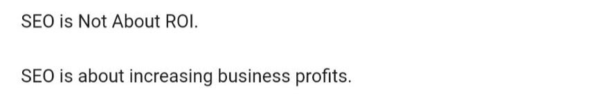

> **Say "ROI" again! C'mon, say "ROI" again! I dare ya, I double dare ya, say "ROI" one more goddamn time!**
>
> Anon

We need to talk about ROI.

Actually, I take that back, the term 'ROI' is used far too often.

We need to talk about *not* talking about ROI.

## ROI should only mean one thing

Every marketer knows that ROI stands for 'Return on Investment' and it's what we want to measure when we assess the effectiveness of marketing campaigns. That bit is easy but then things go rapidly sideways... There are short and long term ROI's. Web sales and physical retail sales ROI. Revenue ROI and profit ROI. Or is one of those [ROAS](https://web.archive.org/web/20230927155346/https://www.aarki.com/insights/roi-vs-roas)? You'll even see the ROI label applied to metrics that have nothing to do with financial performance at all, like web traffic and brand awareness.

This is one of the reasons why marketers struggle to get taken seriously by finance departments and in the boardroom. In the rest of the world, there is only one sensible definition of ROI.

It's this:

---

**The ROI of an advertising campaign is the difference between the profit the business makes if it runs the campaign and the profit that the business makes if it doesn't run the campaign.**

---

Yes, it's usually expressed as profit divided by cost but we always know the cost, the question is what are we dividing by cost?

If it's any metric other than difference in total profitability of the company, then it's not ROI.

It might still be *useful* but it isn't ROI.

If you think I'm setting up a straw man, take this example that I saw on LinkedIn just this week.

I won't include the poster because it's an industry problem, not an individual problem but I'm sorry, what? SEO is not about ROI, it's about profit? Then what on earth is ROI?

The term ROI has been so abused by marketers that some apparently think it doesn't mean profit.

If you applied this type of thinking to a financial investment you'd be laughed out of the room.

## So we should measure profit?

Well, yes. But.

The problem is that by using the proper definition of ROI - incremental profit - it becomes incredibly difficult, or even impossible to measure. This is why it gets abused to mean other things.

Ad campaigns work over a long period and their effect may be cumulative, so you can't calculate ROI until a long time after they run.

The many parts of an advertising campaign work together, preventing us from isolating the impact on profit of a single advert.

Depending on what our competitors are doing and the wider of health of the business, profit might be static, or even falling, despite our adverts.

Does advertising retain existing customers? Allow you to charge a higher price and run fewer discount promotions? Allow you to launch more sub-brands? Make your staff happier so they're less likely to quit? If it does then you'll need to measure those things in your ROI calculation.

And profit is complicated. Involving yourself in profit calculations for large companies leads you into areas of the financial map marked 'here be dragons'.

## Nobody can measure advertising ROI.

We should admit that. Trust the analysts who are willing to admit that. If we accept that ROI actually means total difference in profits over the long term, then we usually can't measure it.

We can sometimes glimpse it by running well-structured test and control experiments but you can't run those kinds of tests on all of your marketing activities, all of the time.

We can see it by looking at meta analyses over long periods of time, analysing the drivers of success across many businesses. But we can't do it on *a single, specific business*, for last week's campaign.

We need some honesty in the conversation about advertising ROI. It is not measurable.

## Which means we should stop using the term 'ROI'

The problem isn't the metrics we use in advertising. Well OK, sometimes it is, but we do have plenty of smart people building clever, accurate models. A lot of effort goes into the effectiveness measurements that we generate and those measurements are valuable.

The problem is that we call those metrics ROI when they aren't. Using the term 'ROI' when you know that's not really what you're measuring is at best lazy and at worst dishonest.

From econometricians to direct response specialists, everyone is using the term ROI to mean *something other than what it actually means*. Some of those groups are closer to the real meaning and some are further away but nobody working only on the data from one solitary business is truly measuring ROI because it's effectively impossible to do.

Don't believe me?

Do you ruthlessly and immediately eliminate all advertising that has a measured ROI below 1.0?

Or do you prevaricate and talk about the long term, halo effects and share of voice?

Of course you do. Everyone does.

That's because you know that you haven't actually measured the true total ROI for the campaign.

The term ROI should be confined to genuine attempts to measure advertising's effect on total profitability, which means it should be used only very rarely.

## So what do we do instead?

We call our metrics what they actually are.

What are you measuring?

Clicks? Web visitors? Sales over the life of the campaign? *Say that*.

Don't talk about ROI, talk about responses. You're measuring the different ways that customers are responding, in the short term or in the longer term, online or offline, sometimes by measuring their shopping behaviour and sometimes by asking them questions.

Rather than quoting ROI, quote a cost-per-response. Make the definition of that response specific and give it a time horizon.

*Cost per click, last week.*

*Cost per incremental sale, during the campaign.*

*Cost per additional awareness point, last year.*

Now you're on much more solid ground because you're describing what you have actually measured. You're also providing numbers that a finance department might be able to work with, on their way to forecasting profit.

Saying what we mean is important.

I pledge not to say 'ROI' any longer when that's not really what I mean. Who's with me?
