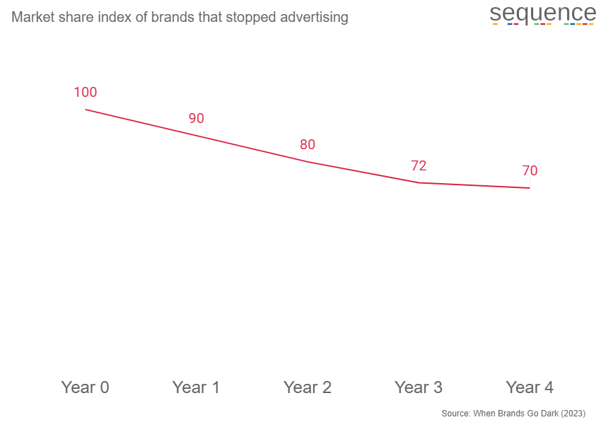

An update to an important study was released earlier this year, so with full credit to the original paper (which you should definitely [read](https://doi.org/10.2501/JAR-2023-009)), let me introduce you to the most important chart in advertising...

How many of your sales are driven by advertising? Even econometrics (marketing mix modelling) can't really tell you. Marketing mix models are very useful but they don't know what will happen if you simply turn off all of your ads and then leave them turned off (which incidentally is why we should stop saying that econometrics - or almost any other marketing measurement technique - [measures ROI]()).

If you turn everything off, of course sales will fall but where's the floor? And how fast do you reach it? The authors of "[When Brands Go Dark](https://doi.org/10.2501/JAR-2023-009)" (2023) identified 377 consumer goods products in the US that simply stopped advertising. We don't know the reasons why they did that and the original paper discusses methodology, caveats and all sorts of additional interesting breakdowns but we have a study of what happened to a set of brands that actually did turn off all of their ads.

Here are the headlines...

**If you stop advertising, market share drops *and then carries on falling. For years*.**

**After four years, brands that stopped advertising had lost an average of 30% of their market share.**

---

---

Why is this is the most important chart in advertising?

It's strong evidence that advertising does more than our 'ROI' models measure. The brands in this study lost 10% market share after one year - which you might get close to measuring with a good econometric model - but four years after stopping advertising they had lost 30% market share.

Too often, we consider our own advertising in isolation, talking about cost per acquisition or ROI without reference to our competitors, as if advertising simply buys new customers. Which is only one of the things that it does.

Advertising also defends the market share we already have. Stop advertising and you might find that its true value is three times what you thought it was.
